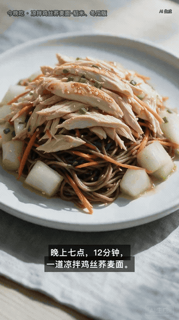

<p align="center">
  
</p>

# Meal Reel

每天从你的食材库存里选一道不重样的菜，拍成一条 9:16 竖屏短片：AI 配图、真人配音、烧进画面的中文字幕。

<p align="center">
  
</p>

<p align="center">
  <sub>示例：凉拌鸡丝荞麦面（减脂餐，成本 ¥3）。<a href="assets/demo/demo.mp4">完整 20 秒带配音版</a>（mp4 需下载，GitHub 不给内嵌播放器）</sub>
</p>

## Install

```bash
git clone https://github.com/wjl0313/Meal-Reel && cd Meal-Reel
python3 tools/doctor.py
```

`doctor.py` 会列出缺的东西。只有三样依赖：Python 3.8+（纯标准库，不用 `pip install`）、带 libass 的 ffmpeg、一个中文字体。ffmpeg 缺 libass 时字幕不会烧进画面，退出码依然是 0，所以这一步别跳。缺了跑 `python3 tools/fetch_ffmpeg.py` 补上。

## Quickstart

```bash
cp .env.example .env        # 填方舟 key 与语音凭据
python3 run.py --user U001 --slot dinner
```

产物在 `runs/2026-10-30_dinner/final.mp4`：1080×1920、30fps、约 20 秒。首次跑 3 到 4 分钟，4 张图串行生成；之后命中图片缓存只要十几秒。

## 它做什么

- **选菜**：1093 道真实菜谱，按营养和预算打分，缺的食材用库存里的同类平替。60 天冷却加历史记录，保证每天不重样。
- **成片**：4 张分镜图、豆包配音、硬字幕，一条约 20 秒。
- **三餐**：`./daily3.sh` 出早午晚三条并拼成一条，三餐互不重样。
- **发送**：`./send_wecom.sh` 发到企业微信，视频加文字清单两条消息。
- **调参**：`python3 serve.py` 开本地页面改预算、餐次、音色、字幕，保存即写回 `config.json`。

## 配置

`.env` 只放密钥，`config.json` 放界面参数，后台页面只写后者。全部键和取值见 [配置与命令](docs/usage.md)。

## 文档

- [环境与部署](docs/setup.md)：目录结构、macOS 与 Windows 差异、换设备要拷什么
- [配置与命令](docs/usage.md)：密钥、界面参数、库存清单格式、全部命令行参数
- [自检与排错](docs/faq.md)：怎么确认这次跑对了，以及踩过的坑

## License

GPL-3.0
